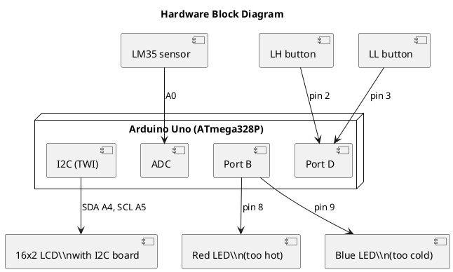
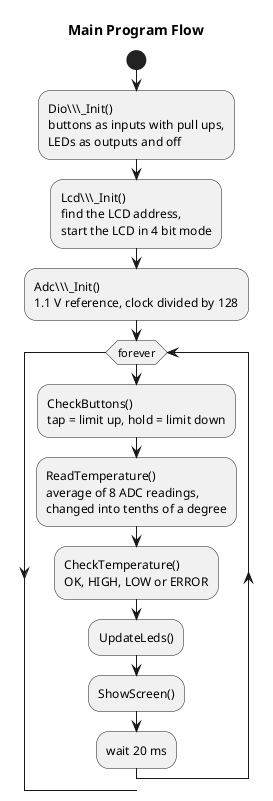

TEMPERATURE HMI USING ATMEGA328P

Module: KH5048CEM Embedded System Design and Development  
Element 2: Human Machine Interface

Team members:  
Yahia Khalaf, 2401241  
Ziad Ahmed, 2500131  
Amr Khaled, 2401565


GitHub repository:


Demo video: demo\_video.mp4 in the GitHub repository


CONTENTS

1. Introduction
2. Requirements
3. Hardware and Wiring
4. Design Architecture
5. How the Code Works
6. Coding Rules
7. Test Cases
8. Bill of Materials
9. Optimised Bill of Materials
10. Code Submission
11. Demo Video
12. Conclusion


1. INTRODUCTION

For this project we made a small screen that shows the temperature, like the one in a car.

An LM35 sensor measures the temperature. The ATmega328P on the Arduino Uno reads the sensor and shows the temperature on a 16x2 LCD. We use two buttons to set a high limit called LH and a low limit called LL. When it gets hotter than LH, a red LED turns on. When it gets colder than LL, a blue LED turns on. If the sensor stops working, both LEDs turn on.

We wrote all the code in C using the registers of the microcontroller, the same way we did in the labs. We did not use any Arduino functions or ready made libraries.


2. REQUIREMENTS
3. Read the temperature from an analog sensor using the ADC.
4. Show the temperature on a 16x2 LCD.
5. Use one button for the high limit and one button for the low limit.
6. Use LEDs to warn when the temperature is outside the limits.
7. Write the code in C only, with no Arduino code and no ready made libraries.
8. Make sure the low limit always stays below the high limit.
9. Stay safe if the sensor stops working.


1. HARDWARE AND WIRING



The Arduino 5V pin goes to the plus line of the breadboard and the GND pin goes to the minus line. Everything below that says 5V or GND connects to these lines.

LCD with I2C board  
VCC goes to 5V  
GND goes to GND  
SDA goes to A4  
SCL goes to A5

LM35 sensor (flat side facing you, legs pointing down)  
Left leg goes to 5V  
Middle leg goes to A0  
Right leg goes to GND

High limit button  
One leg goes to pin 2 and the other leg goes to GND

Low limit button  
One leg goes to pin 3 and the other leg goes to GND

Red LED  
Pin 8 goes to a 220 ohm resistor, then to the long leg of the LED. The short leg goes to GND.

Blue LED  
Pin 9 goes to a 220 ohm resistor, then to the long leg of the LED. The short leg goes to GND.

The buttons do not need resistors because we turn on the pull up resistors inside the microcontroller. A button reads 0 when it is pressed and 1 when it is not.


4. DESIGN ARCHITECTURE

The code is split into 7 files. There is one main program and three drivers. Each driver controls one part from the assignment diagram: the ADC, the LCD, and the inputs and outputs. Each driver has a header file that lists its functions and a code file with the actual code, the same way we made the UART and DIO files in the lab.

The design has two layers. The main program is the top layer. It only calls the driver functions and never uses the registers itself. The three drivers are the bottom layer, and only they use the registers. Because of this, if we change how a part is connected, we only need to change its driver.

```plantuml
@startuml software\\\_layers
title Software Layers

package "Application layer" {
  component "TempHMI\\\_zh\\\_yk\\\_ah.ino\\\\nmain program" as APP
}

package "Driver layer" {
  component "adc.h / adc.ino" as ADC
  component "lcd\\\_final.h / lcd\\\_final.ino" as LCD
  component "dio.h / dio.ino" as DIO
}

package "ATmega328P registers" {
  component "ADMUX, ADCSRA, ADC" as R\\\_ADC
  component "TWBR, TWCR, TWDR, TWSR" as R\\\_TWI
  component "DDRB, PORTB, DDRD, PORTD, PIND" as R\\\_IO
}

APP --> ADC : Adc\\\_Init()\\\\nAdc\\\_ReadChannel()
APP --> LCD : Lcd\\\_Init()\\\\nLcd\\\_GoTo()\\\\nLcd\\\_PrintString()\\\\nLcd\\\_PrintNumber()
APP --> DIO : Dio\\\_Init()\\\\nDio\\\_ButtonPressed()\\\\nDio\\\_LedOn() / Dio\\\_LedOff()
ADC --> R\\\_ADC
LCD --> R\\\_TWI
DIO --> R\\\_IO
@enduml
```

The files are:

TempHMI\_zh\_yk\_ah.ino is the main program. It handles the temperature, the buttons, the limits, the screen and the LEDs.

adc.h and adc.ino set up the ADC and read the sensor.

lcd\_final.h and lcd\_final.ino control the LCD through its I2C board.

dio.h and dio.ino read the two buttons and turn the two LEDs on and off.

What the program does

When the Arduino turns on, the program sets up the buttons, the LEDs, the LCD and the ADC. Then it repeats these steps forever:

1. Check the buttons and change the limits if needed.
2. Read the temperature.
3. Decide if the temperature is OK, too high, too low, or if there is a sensor error.
4. Turn the LEDs on or off.
5. Show everything on the LCD.



When the warning turns off

When the temperature goes above LH, the red LED turns on. It only turns off again when the temperature is half a degree below LH. The blue LED works the same way with LL. This small gap stops the LEDs from flickering when the temperature is very close to a limit.

```plantuml
@startuml temperature\\\_status
title Temperature Status

\\\[\\\*] --> OK

OK : both LEDs off
HIGH : red LED on
LOW : blue LED on
ERROR : both LEDs on

OK --> HIGH : temperature above LH
OK --> LOW : temperature below LL
HIGH --> OK : temperature 0.5 C below LH
LOW --> OK : temperature 0.5 C above LL
OK --> ERROR : ADC reading at maximum
HIGH --> ERROR : ADC reading at maximum
LOW --> ERROR : ADC reading at maximum
ERROR --> OK : valid reading again
@enduml
```

The screen

The top line shows the temperature and the status, for example: Temp: 25.3C OK  
The bottom line shows the two limits, for example: LL:20C   LH:30C

We always write all 16 characters on each line, so the old text gets covered and we never need to clear the screen. This stops the screen from flickering.


5. HOW THE CODE WORKS

Reading the temperature. The LM35 gives 10 millivolts for every degree. We set the ADC to use the 1.1 volt reference inside the chip instead of 5 volts. This makes each step about 1 millivolt, which is about a tenth of a degree. With 5 volts each step would be almost half a degree. We read the sensor 8 times and take the average so the number does not jump around.

No decimals. We keep the temperature in tenths of a degree, so 253 means 25.3 degrees. This is simpler and faster than using decimal numbers on a small microcontroller. Because the LM35 gives 1 millivolt for every tenth of a degree, the millivolts are already the temperature in tenths.

The LCD. Our LCD has an I2C board on the back, so it only needs two signal wires. The board takes each byte we send and passes it to the LCD pins. Each character is sent in two halves because the LCD uses 4 data wires. When the program starts, it searches for the LCD board by itself, so it works with any board address. Every wait has a time limit, so the program keeps running even if the LCD is unplugged. I2C was not covered in the labs, so we took the I2C register settings from the ATmega328P datasheet.

The buttons. A short tap raises the limit by 1. Holding the button for about half a second lowers the limit by 1, and it keeps going down about 3 times a second until you let go. The tap only counts when you let go of the button, which is how the program knows the difference between a tap and a hold.

```plantuml
@startuml button\\\_handling
title Button Handling (checked once every loop)

\\\[\\\*] --> Released

Released --> Pressed : button pressed
Pressed --> Released : let go before HOLD\\\_START\\\\n/ limit goes up by 1
Pressed --> Holding : held for HOLD\\\_START loops\\\\n/ limit goes down by 1
Holding --> Holding : every HOLD\\\_REPEAT loops\\\\n/ limit goes down by 1
Holding --> Released : let go
@enduml
```

The limits. LH can go up to 99 and LL can go down to 0. LH always stays at least 1 degree above LL, and LL always stays at least 1 degree below LH, so the limits always make sense.

Safety. The LEDs are set up first so they start off. If the sensor reading is at the very top of the ADC range, the screen shows Sensor ERROR and both LEDs turn on.


6. CODING RULES

Each driver function starts with the name of its driver, the same way as the ADC functions from the lab.

Each driver has a header file with an include guard and the list of its functions.

Important numbers like the highest limit and the hold time are given names at the top of the file.

Bits are set, cleared and checked the same way we learned in the lab.

The pins of each driver are named in its header file, so they are easy to find and change.

Every wait for the LCD has a time limit so the program never freezes.

The code is kept short and has simple comments next to the important lines.


7. TEST CASES

The test cases are in the file tests/TempHMI\_Robot\_Tests.txt. We ran all of them on the real board and all of them passed.


8. BILL OF MATERIALS

The full list is in the file bom/BOM.csv. These are approximate prices from electronics shops in Egypt in November 2026.

1. Arduino Uno with USB cable, 1 piece, 340 EGP
2. 16x2 LCD with I2C board, 1 piece, 110 EGP
3. LM35 temperature sensor, 1 piece, 30 EGP
4. LEDs, one red and one blue, 2 EGP
5. 220 ohm resistors, 2 pieces, 1 EGP
6. Push buttons, 2 pieces, 2 EGP
7. Breadboard, 1 piece, 50 EGP
8. Jumper wires, 1 set, 40 EGP

Total: about 575 EGP


9. OPTIMISED BILL OF MATERIALS

The full list is in the file bom/Optimized\_BOM.csv.

If we made this as a real product, like a small display in a car, we would not need the Arduino board, the breadboard or the jumper wires. The chip would go on a small circuit board and take its power from the car's 12 volt supply.

1. ATmega328P chip on its own, about 185 EGP. It is the same chip and runs the same code, without the rest of the Arduino board.
2. 16x2 LCD without the I2C board, 65 EGP. The chip on its own has enough free pins to connect the LCD directly, so the I2C board is not needed.
3. 10k potentiometer, 3 EGP. It sets the LCD contrast, which the I2C board used to do.
4. LM35 sensor, 30 EGP.
5. Two LEDs with their resistors, 3 EGP.
6. Two push buttons, 2 EGP. They still do not need resistors.
7. L7805 regulator with 2 capacitors, 10 EGP. It turns the car's 12 volts into 5 volts.
8. One small capacitor and one resistor for the chip, 2 EGP.
9. Small circuit board, 20 EGP. It replaces the breadboard and wires.

Total: about 320 EGP, which is about 44 percent cheaper than our prototype.

We can save even more because:  
The chip can use its own 8 MHz clock, so we do not need a crystal.  
The chip is programmed once in the factory, so it does not need the USB chip from the Arduino.  
Buying 100 or more of each part usually makes them 10 to 30 percent cheaper.


10. CODE SUBMISSION

All our code is on GitHub: https://github.com/ziadelhawary500-blip/TempHMI\_zh\_yk\_ah\_FINAL

The repository has the TempHMI\_zh\_yk\_ah folder with the 7 code files, the tests folder with the test cases, the bom folder with the two CSV parts lists, the README file, this report, and the demo video.

To upload the code, open TempHMI\_zh\_yk\_ah.ino in the Arduino IDE, choose Arduino Uno and click Upload.


11. DEMO VIDEO

The video is the file demo\_video.mp4 in our GitHub repository. It shows the temperature reading on the LCD, raising LL above the temperature so the screen shows LOW and the blue LED turns on, and lowering LH below the temperature so the screen shows HIGH and the red LED turns on.

Video: demo\_video.mp4 in the GitHub repository


12. CONCLUSION

We built a working temperature display on the ATmega328P using C and the registers only. The code is split into a main program and three drivers, which makes it easy to read and change.

The system handles the tricky cases: limits that do not make sense, the difference between a tap and a hold, LEDs flickering near a limit, a sensor that stops working, and the LCD being unplugged.

Our optimised parts list shows that the same design could be made as a real product for about 44 percent less than our prototype.

